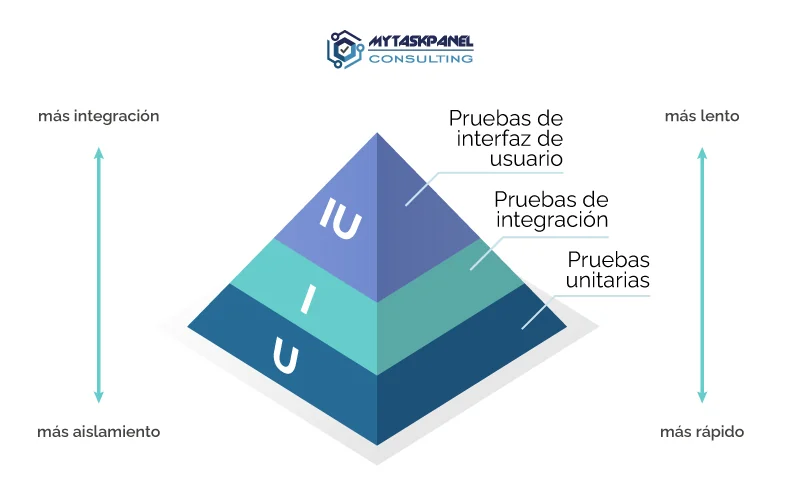

# ¿Qué es el Testing?

El **Testing** es el proceso de comprobar que un programa funciona correctamente y produce los resultados esperados, con la idea de encontrar errores antes de que sean encontrados por el usuario.

## ¿Por qué hacer testing?

El **Testing** nos ayuda a:
1. Encontrar errores.
2. Comprobar que el código funciona correctamente.
3. Evitar que los nuevos cambios que realicemos rompan las funcionalidades existentes.
4. Mejorar la calidad de nuestras aplicaciones.
5. Tener más confianza al modificar nuestro código.

## ¿Cuál es nuestro objetivo?

Probar código consiste en verificar que un programa funciona como se espera ante diferentes escenarios. Existen varias formas de verificar esto.

### Pruebas Manuales

Es la ejecución el código en consola. Probar valores manualmente y observar el resultado. Este tipo de prueba es de inspección visual, lo que lo hace propenso a errores humanos que con frecuencia se pueden tornar repetitivos. Adicionalmente su ejecución nos ocupa demasiado tiempo.

### Pruebas Automatizadas

Es el diseñar un segundo código que ejecuta al código principal (nuestra aplicación), con diferentes entradas, verificando los resultados automáticamente. Se ejecutan en segundos y garantizan que los cambios realizados no roman lo que ya funcionaba bien.

## Tipos de Pruebas

Dentro de los tipos de pruebas tenemos:

### 1. Pruebas de Interfaz de Usuario

Este tipo de prueba también es conocido como pruebas End-to-End (E2E), donde vamos a simular el flujo completo del usuario en la aplicación final. 

### 2. Pruebas de Integración

En este tipo de prueba comprobamos la comunicación entre dos o más módulos (Ej: Guardar un usuario en la base de datos)

### 3. Pruebas Unitarias

En este tipo de prueba se verifican pequeás unidades de código aisladas (Ej: Una funcion o método de una clase)



## Herramientas de Testing en Python

### 1. UnitTest

Viene incluido en Python, pero exige una sintásis heradada de Java con clases y métodos verbosos.

__Ejemplos__:

Archivo: `sumar.py`

```Python
# 1. Define funcionalidad
def sumar( a, b ):
    return a + b

# 2. Implementa el Testing usando funcion nativa de Python
# assert (Validaciones):
#   <condicion que debe ser verdadera>
#   <mensaje de error si falla>
resultado = sumar(3, 2)

# Se valida que el resultado sea el esperado
assert resultado == 5, "La suma es incorrecta"
```

Archivo: `multiplicar.py`

```Python
# 1. Define funcionalidad
def multiplicar( a, b ):
    return a * b

# 2. Implementa el Testing usando funcion nativa de Python
def test_multiplicar():
    # Se define la funcion que contiene las validaciones (tests)

    # Se valida que el resultado sea el esperado
        # assert (Validaciones):
        #   <condicion que debe ser verdadera>
        #   <mensaje de error si falla>

    resultado = multiplicar(1, 2)
    assert resultado == 2, "La multiplicación es incorrecta"

    resultado = multiplicar(-1, -1)
    assert resultado == 1, "La multiplicación es incorrecta"

    resultado = multiplicar(1, -1)
    assert resultado == -1, "La multiplicación es incorrecta"

    print("✅ Todos los tests pasaron")

test_multiplicar()

```

### 2. PyTest

Utiliza Python Nativo y requiere mucho menos código

1. __Instalación Global__

    ```bash
    pip3 install pytest
    ```

    Qué significa esto en la práctica

    | Nivel | ¿Se instaló ahí? | Descripción |
    | :--- | :---: | :--- |
    | __Global del Sistema__ `/user/lib/...` | No | No afectó al sistem operativo, ni está disponible para todos los usuarios de la máquina |
    | __Global de tu usuario__ `/user/lib/...` | Sí | Podrás usar `pytest` desde cualquier directorio o proyecto que abras con su usuario |
    | __Entorno Virtual__ `.venv`| No | No quedó aislado en este proyecto en particular |

    __¿Por qué pasó esto?__

    Al no usar `sudo` (permisos de administrador), ni estar dentro de un entorno virtual, `pip3` protegió a tu sistema operativo y aplicó automáticamente el modo `--user`

    > _Defaulting to user installation because normal site-packages is not writeable_

    Se guardo en: `/home/jcarlosj/.local/lib/python3.14/site-packages` 

2. __Verificamos que ha sido instalado correctamente__

    __Opción 1:__ Forma directa
    ```bash
    pytest --version
    ```

    __Opción 2:__ A través del interprete de Python
    ```bash
    python3 -m pytest --version
    ```

    __Opción 3:__ Ver detalles y ruta exacta con `pip3`
    ```bash
    pip3 show pytest
    ```

    __Opción 4:__ Ver ruta ejecutable 
    ```bash
    which pytest
    ```

3. __Implementación de Prueba Unitaria usando PyTest__

    Archivo: `mayor_edad.py`

    ```Python
    def es_mayor_de_edad(edad):
    """
    Determina si una persona es mayor de edad.

    Args:
        edad (int): La edad de la persona.

    Returns:
        bool: True si es mayor de edad (>= 18), False en caso contrario.
    """
    return edad >= 18
    ```

    Archivo: `test_mayor_edad.py`
    ```Python
    from mayor_edad import es_mayor_de_edad

    def test_es_mayor_de_edad():
        # Caso 1: Es mayor de edad (18) 
        assert es_mayor_de_edad(18) == True
        assert es_mayor_de_edad(18) is True

        # Caso 2: Es menor de edad (0)
        assert es_mayor_de_edad(0) == False
        assert es_mayor_de_edad(0) is False 

        # Caso 3: Es menor de edad (17)
        assert es_mayor_de_edad(17) == False
        assert es_mayor_de_edad(17) is False    

        # Caso 4: Es menor de edad (-1)
        assert es_mayor_de_edad(-1) == False
        assert es_mayor_de_edad(-1) is False
    ```

4. __Ejecutar Prueba:__

    Para ejecutar la prueba solo debe escribir en la terminal el comando

    ```bash
    pytest
    ```